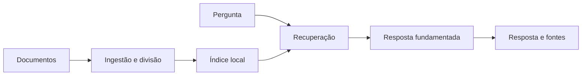

# Assistente Inteligente com RAG

Aplicação para consultar documentos com respostas fundamentadas nas fontes carregadas. O projeto implementa um pipeline RAG completo: ingestão, divisão do conteúdo em trechos, recuperação por relevância e geração de resposta com referências.

O modo local funciona sem chave externa e produz respostas extrativas. Quando `OPENAI_API_KEY` está configurada, o mesmo contexto recuperado pode ser enviado a um modelo da OpenAI.

## Fluxo



## Funcionalidades

- leitura de arquivos `.txt`, `.md` e `.pdf`;
- divisão configurável com sobreposição;
- busca local por relevância, sem banco externo;
- resposta com indicação das fontes utilizadas;
- interface web em Streamlit;
- uso opcional da OpenAI;
- execução por linha de comando;
- testes automatizados do núcleo RAG.

## Executar localmente

```bash
python -m venv .venv
pip install -r requirements.txt
streamlit run app.py
```

A interface permite enviar documentos ou usar a base de demonstração em `knowledge_base/`.

### Linha de comando

O núcleo local utiliza somente a biblioteca padrão do Python:

```bash
python cli.py "Qual é a política de trabalho remoto?"
```

### OpenAI opcional

Copie `.env.example` para `.env` e informe sua chave:

```bash
OPENAI_API_KEY=sua_chave
OPENAI_MODEL=gpt-4.1-mini
```

Sem essa configuração, nenhuma chamada externa é realizada.

## Testes

```bash
python -m unittest discover -s tests -v
```

## Estrutura

```text
app.py                 interface Streamlit
cli.py                 execução por terminal
knowledge_base/        documentos de demonstração
src/rag_assistant/     núcleo de ingestão, busca e resposta
tests/                 testes automatizados
```

## Tecnologias

`Python` `RAG` `Streamlit` `OpenAI opcional` `Docker`

## Limitações do MVP

- o índice é mantido em memória durante a execução;
- a recuperação local é lexical e não utiliza embeddings;
- arquivos digitalizados precisam de OCR antes da ingestão.

## Autoria

[Geovanna Eduarda da Silva](https://github.com/geovannasilva15)
