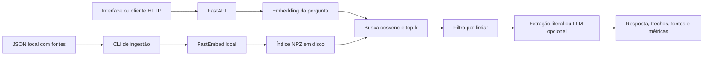

# AI Reliability Lab

Laboratório local de perguntas sobre documentos, com busca semântica, fontes inspecionáveis e avaliação reproduzível. O objetivo é observar o que um pequeno sistema RAG recupera, quando responde e onde falha.

**Autoria: Geovanna Eduarda da Silva.** Projeto de portfólio em evolução. Os resultados pertencem a uma base didática pequena e não demonstram confiabilidade geral.


[Consulta real com resposta e métricas](docs/images/demo-sources.jpg). A [captura completa inicial](docs/images/demo-desktop.jpg) registra a primeira versão do conjunto de avaliação; os resultados atuais estão na seção Avaliação abaixo.

## O problema e as funcionalidades

Uma resposta fluente pode esconder falta de evidência. Aqui a consulta inclui os trechos encontrados, seus identificadores, origem e métricas de execução. A avaliação separa recuperação, abstenção e validade das referências. Recuperar uma fonte não comprova que uma resposta esteja correta.

- Três documentos próprios de demonstração sobre RAG, avaliação e desenvolvimento responsável; 12 seções na configuração padrão.
- Limpeza de espaços, divisão por seção e janelas de palavras com sobreposição.
- Embeddings multilíngues locais com FastEmbed/ONNX e busca cosseno exata com NumPy.
- Índice persistido com metadados, hash da base e atualização atômica.
- FastAPI e interface responsiva em HTML/CSS/JavaScript, servidos pela mesma aplicação.
- Modo extrativo sem chave e integração opcional com endpoint compatível com Chat Completions.
- 16 casos de avaliação, comparação top-k 3 versus 5 e resultados por pergunta.
- Testes offline com Pytest e workflow de GitHub Actions.

## Arquitetura e caminho de uma pergunta



A ingestão é separada das consultas. O servidor carrega o índice na primeira consulta e o reutiliza. O modelo também é carregado uma vez por processo. Nenhum índice é reconstruído ao fazer perguntas. Reinicie o servidor após atualizar documentos, índice ou configuração: não há recarga automática em execução.

FastEmbed evita instalar PyTorch e roda em CPU. O modelo escolhido é `sentence-transformers/paraphrase-multilingual-MiniLM-L12-v2`, disponibilizado em ONNX quantizado. A lista da biblioteca informa aproximadamente 0,22 GB para os pesos; arquivos auxiliares e cache exigem espaço adicional. Consulte a [documentação do FastEmbed](https://qdrant.github.io/fastembed/examples/Supported_Models/). O primeiro uso exige internet para baixar o modelo público, sem cadastro ou chave paga. Depois, o modo demo funciona com o cache local. Downloads podem falhar por proxy, bloqueios ou limites do serviço.

NumPy faz busca exata nos vetores normalizados, sem banco ou servidor adicional. É adequado a 12 trechos, com custo de busca linear no tamanho da base. Não é uma arquitetura dimensionada para milhões de documentos. `similarity` é cosseno, não confiança ou probabilidade de acerto.

## Estrutura

```text
lab/                    configuração, ingestão, busca, geração, API, CLI e avaliação
web/                    interface conectada a /ask e /evaluations
data/documents/         textos de demonstração e metadados
data/evaluation.json    perguntas, pontos e fontes esperadas, justificativas
tests/                  testes atuais, com substitutos de encoder e HTTP
reports/                execuções reais, datadas, e latest.json
docs/                   análise do repositório, verificação e capturas reais
legacy/                 implementação anterior preservada integralmente
.github/workflows/      CI de testes
storage/                índice gerado, ignorado pelo Git
.cache/                 modelo baixado, ignorado pelo Git
GUIA_DE_APRESENTACAO.md  material de estudo e entrevista
```

## Instalação e modo sem chave

Pré-requisitos: Python **3.12**, Git, internet para instalar pacotes e baixar o modelo no primeiro uso. Verificado em Windows com CPU. Recomenda-se reservar pelo menos 1 GB livre para ambiente e cache; o consumo depende da plataforma. O workflow usa Linux, cuja execução deve ser conferida no PR.

No PowerShell:

```powershell
git clone --branch codex/ai-reliability-lab https://github.com/geovannasilva15/assistente-inteligente-rag.git
cd assistente-inteligente-rag
python -m venv .venv
.\.venv\Scripts\python -m pip install -r requirements.txt
Copy-Item .env.example .env
.\.venv\Scripts\python -m lab ingest
.\.venv\Scripts\python -m uvicorn lab.api:app --host 127.0.0.1 --port 8000 --no-access-log
```

Não é preciso ativar o ambiente virtual ou alterar a política de execução do PowerShell. O repositório era privado na inspeção: use uma conta autorizada para clonar. Nenhuma mudança de visibilidade foi solicitada. Após eventual merge, também será possível clonar a `main` atualizada.

Em macOS/Linux, substitua o executável por `.venv/bin/python`; para copiar a configuração, use `cp .env.example .env`. Esses comandos equivalentes não foram executados localmente nesta entrega.

Abra [a interface local](http://127.0.0.1:8000) e [a documentação interativa da API](http://127.0.0.1:8000/docs). Use Ctrl+C para encerrar o servidor.

Pergunta sugerida: **“O que significa top-k e qual o risco de aumentar esse valor?”** Expanda **Ler trecho e origem** para conferir texto, título, seção, ID e referência pública. **Todos os trechos recuperados** inclui candidatos abaixo do limiar; eles não foram usados na resposta.

O modo **Demonstração extrativa** copia literalmente os trechos aprovados e acrescenta `[id]`. Não é resposta pré-programada nem síntese por LLM. Pode trazer texto excessivo ou apenas relacionado à pergunta. No modo demo, tokens e custo ficam **indisponíveis**, não “zero”. Não há chamadas de geração ao provedor.

## Criar ou atualizar o índice

Edite ou acrescente JSONs em `data/documents/` seguindo os exemplos: ID único, título, organização, URL, data, condições e seções com ID, título e texto. A v1 lê somente esse formato; não faz upload, scraping, OCR ou extração de PDF na aplicação atual.

```powershell
.\.venv\Scripts\python -m lab ingest
```

O comando recria integralmente o índice. Cada seção é dividida em até 90 palavras com 15 de sobreposição, sem misturar fontes. Os 12 textos atuais cabem em uma janela por seção. Os testes exercitam sobreposição com janelas menores. A contagem é de palavras, não tokens do encoder; textos personalizados muito longos podem ser truncados pelo modelo. Não aumente a janela sem investigar esse limite.

O índice armazena modelo, parâmetros, data UTC e hash SHA-256 dos arquivos. Ao carregar um índice incompatível ou desatualizado, a consulta pede nova ingestão. Reinicie o servidor para usar a versão nova. Não carregue índices de terceiros não confiáveis.

## API e exemplos

| Rota | Comportamento |
|---|---|
| `GET /health` | Confere se o índice pode ser carregado; 503 se ausente/incompatível. Não testa o provedor nem aquece o encoder. |
| `POST /ask` | Valida pergunta, modo e top-k; retorna resposta, fontes, candidatos, configuração e métricas. |
| `GET /evaluations` | Lê o último relatório ou informa `not_run`. Não dispara avaliações. |
| `GET /docs` | OpenAPI interativa. |

Ingestão e avaliação são operações CLI, sem endpoint administrativo exposto.

Exemplo PowerShell, com o servidor iniciado:

```powershell
$body = @{ question = 'O que significa top-k e qual o risco de aumentar esse valor?'; top_k = 3; mode = 'demo' } | ConvertTo-Json
Invoke-RestMethod -Uri http://127.0.0.1:8000/ask -Method Post -ContentType 'application/json; charset=utf-8' -Body ([Text.Encoding]::UTF8.GetBytes($body))
```

JSON equivalente:

```json
{"question":"O que significa top-k e qual o risco de aumentar esse valor?","top_k":3,"mode":"demo"}
```

Recorte de uma resposta observada nessa consulta, omitindo a maior parte do texto e dos metadados. O tempo varia por execução:

```json
{
  "mode": "demo",
  "answerable": true,
  "cited_ids": ["rag:topk:0", "evaluation:hit:0"],
  "metrics": {
    "latency_ms": 17.986,
    "retrieved_count": 3,
    "context_count": 2,
    "input_tokens": null,
    "output_tokens": null,
    "estimated_cost": null
  }
}
```

A resposta completa contém `answer`, `sources` com textos/metadados, `retrieved` com todos os candidatos, `config` e `executed_at`. `answerable` indica a decisão operacional do sistema, não uma verdade sobre a pergunta. Perguntas em branco, maiores que 1000 caracteres, modos inválidos ou top-k fora de 1–10 recebem 422. Falhas locais recebem 503; erros de provedor/configuração LLM recebem 502 com mensagem sanitizada.

## LLM opcional

Configure no `.env` do servidor:

```dotenv
RESPONSE_MODE=llm
LLM_BASE_URL=https://api.openai.com/v1
LLM_API_KEY=
LLM_MODEL=
INPUT_PRICE_PER_MILLION=
OUTPUT_PRICE_PER_MILLION=
COST_CURRENCY=USD
```

Preencha chave e identificador de modelo disponível no provedor. O endereço é um exemplo compatível com `/chat/completions`. Não há modelo pago embutido. Reinicie o servidor e selecione **LLM opcional** na interface; o seletor começa em demo mesmo se o padrão da API for LLM. CLI e API sem `mode` usam `RESPONSE_MODE`.

Somente pergunta e textos/IDs aprovados pelo limiar são enviados. O prompt os delimita como dados não confiáveis. O modelo deve devolver JSON com resposta, decisão de abstenção e citações. IDs desconhecidos, ausência de citação ou formato inválido causam erro; não há troca silenciosa para demo. Timeout: 40 segundos. Sem contexto aprovado, o serviço se abstém antes de chamar o provedor.

**Uso externo pode gerar custos e compartilhar a pergunta/contexto com o provedor escolhido.** Verifique suas condições. Prompts e validação de IDs não garantem resistência a injeção nem apoio semântico para cada frase. Um modelo pode citar um trecho real e afirmar algo sem suporte. A integração HTTP foi testada com substitutos; **nenhuma geração paga real foi executada nesta entrega**. Nem todo servidor compatível obedece ao contrato JSON solicitado.

## Evidência insuficiente, métricas e custo

Apenas candidatos com cosseno **≥ 0,45** entram no contexto por padrão. Se nenhum passa, a aplicação informa evidência insuficiente, sem fontes citadas. O LLM também pode se abster mesmo com contexto. O limiar inicial é uma heurística manual, sem calibração em conjunto independente. Admite falsos positivos/negativos observados na avaliação. Não verifica se todos os aspectos da pergunta foram cobertos.

`TOP_K`, `MIN_SIMILARITY`, `CHUNK_WORDS`, `CHUNK_OVERLAP` e `EMBEDDING_MODEL` são configuráveis no `.env`. Alterar modelo ou divisão exige reingestão. Limiar e top-k não exigem novos embeddings. Modelos alternativos devem ser suportados pelo FastEmbed; seus escores não são diretamente comparáveis.

Tempo é medido com `perf_counter`, incluindo busca e geração no servidor. A primeira pergunta inclui carga do encoder; o tempo não inclui rede até o navegador. Tokens são contagens **informadas pelo provedor**, não medidas localmente. Se faltarem contagens ou algum preço, o custo será `null` / indisponível.

`custo = (tokens_entrada × preço_entrada + tokens_saída × preço_saída) / 1.000.000`

Preços são valores definidos por você por milhão de tokens, na moeda informada. Não são atualizados automaticamente. A estimativa simples não inclui descontos, cache, impostos ou outras cobranças. Sem geração paga real, não há estimativa monetária publicada nesta entrega.

## Testes

```powershell
.\.venv\Scripts\python -m pytest -q
.\.venv\Scripts\python -m pip check
```

Passaram localmente **42 testes**, com um aviso de depreciação do TestClient/HTTPX emitido pela dependência Starlette. Cobrem ingestão, limpeza, janelas, sobreposição, metadados, persistência, índice inválido/desatualizado, recuperação controlada, abstenção, API, custo, denominadores de métricas e contrato/erros HTTP do provedor.

O encoder dos testes é um substituto lexical determinístico (`FakeEncoder`): testa o fluxo, não a qualidade dos embeddings reais. O provedor usa `httpx.MockTransport`. Nenhum teste precisa de chave paga, download de modelo ou serviço externo em tempo real. A busca real foi verificada separadamente por ingestão, avaliação e consultas HTTP/navegador em [docs/VERIFICACAO.md](docs/VERIFICACAO.md).

GitHub Actions instala dependências e executa Pytest em pushes e PRs. Confira a execução efetiva na aba Checks; configuração de workflow não é evidência de aprovação remota. Os testes antigos em `legacy/` não são coletados pelo workflow atual.

## Avaliação reproduzível e comparação

```powershell
.\.venv\Scripts\python -m lab evaluate
```

O comando usa o índice, aquece o encoder e executa o mesmo conjunto em **demo** com top-k 3 e 5. Não chama LLM. Cria arquivo datado em `reports/` e atualiza `latest.json`. O painel lê o arquivo em **Consultar última execução**. Há 11 perguntas respondíveis e 5 sem resposta, incluindo perguntas diretas, duas que exigem múltiplas seções e casos próximos ao tema sem o dado solicitado. Confira os resultados individuais: médias ocultam falhas.

| Métrica | Cálculo e limite |
|---|---|
| Hit rate@k | Respondíveis com ao menos uma fonte esperada recuperada / 11. |
| Recall médio@k | Média, nas 11 respondíveis, de fontes esperadas distintas recuperadas / fontes esperadas. |
| Abstenção em não respondíveis | Casos sem resposta em que o sistema se absteve / 5. |
| Taxa de resposta nas respondíveis | Casos respondíveis em que o sistema respondeu / 11. Não mede correção. |
| Validade de citações | Respostas com IDs não vazios, válidos no contexto e coerentes entre texto/lista / respostas emitidas. Não mede suporte semântico. |

As fontes esperadas usam `documento:seção`. Recuperação é medida nos candidatos **antes do filtro**. Uma fonte pode contar para recall e depois ser excluída do contexto, levando à abstenção. Os pontos esperados são checados por presença literal e expostos por caso como diagnóstico; não são uma nota automática de veracidade.

Execução real de **03/11/2026 às 09:35:44 em São Paulo** (`12:35:44 UTC`), Windows, CPU, limiar 0,45, 90 palavras/15 de sobreposição:

| Configuração | Casos | Hit rate | Recall médio | Abstenção sem resposta | Resposta em respondíveis | Tempo total |
|---|---:|---:|---:|---:|---:|---:|
| top-k 3 | 16 | 11/11 (100%) | 95,45% | 4/5 (80%) | 9/11 (81,82%) | 224,057 ms |
| top-k 5 | 16 | 11/11 (100%) | 100% | 4/5 (80%) | 9/11 (81,82%) | 224,444 ms |

As citações foram estruturalmente válidas nas 10 respostas emitidas por configuração. Isso inclui o **falso positivo q14**, que solicita preço atual: foi retornado texto sobre cálculo de custo sem o preço pedido. q01 e q08 tiveram abstenção indevida, apesar de a seção esperada estar no top-k. Com k=3, q09 recuperou só uma das duas seções esperadas. k=5 aumentou recall nesta execução, sem corrigir a decisão de responder ou se abster.

Uma única medição por configuração, em ordem fixa, sem intervalo de confiança e numa base feita para o projeto, não demonstra superioridade geral. Não conclua que k=5 é melhor por padrão: mais contexto pode acrescentar ruído, tokens e custo. A diferença de tempo observada é pequena e não justifica conclusão de desempenho.

Uma execução anterior foi preservada: uma pergunta com falsa premissa foi reformulada para pedir explicitamente um valor recomendado pelo NIST, ausente na base. O hash do conjunto mudou; relatórios de conjuntos diferentes **não são comparação de melhoria do sistema**. Veja [docs/VERIFICACAO.md](docs/VERIFICACAO.md).

## Origem e condições dos documentos

Os arquivos distribuídos são **textos próprios didáticos elaborados para este projeto**, sob [CC BY 4.0](https://creativecommons.org/licenses/by/4.0/), com atribuição ao AI Reliability Lab / Geovanna Eduarda da Silva. Não são documentos oficiais, traduções, pareceres ou material de clientes. Não há reprodução integral de publicações externas. O link exibido é uma **referência pública**, não o local que contém literalmente os textos próprios.

| Texto distribuído | Referência consultada em 03/11/2026 | Responsável pela referência / seção |
|---|---|---|
| RAG na prática | [Artigo RAG](https://arxiv.org/abs/2005.11401) | Lewis et al.; resumo e proposta geral, sem redistribuir o artigo. |
| Avaliação de recuperação | [AI RMF Core](https://airc.nist.gov/airmf-resources/airmf/5-sec-core/) | NIST; seção 5.3 Measure. Fórmulas são escolhas deste protocolo didático. |
| Desenvolvimento responsável | [AI Risk Management Framework](https://www.nist.gov/itl/ai-risk-management-framework) | NIST; apresentação do framework. Práticas operacionais são exemplos próprios. |

Título, organização, referência, data, condições e seção própria acompanham a fonte. As condições do NIST estão disponíveis [nesta página](https://www.nist.gov/open/license); não se presume que todo material de terceiros tenha a mesma condição. O projeto evita essa dependência distribuindo somente textos próprios.

## Histórico preservado

A `main` tinha somente um README inicial. O PR #1 (`implementacao-rag-profissional`) continha Streamlit, ingestão TXT/MD/PDF, busca lexical e testes unittest. Seu conteúdo foi preservado integralmente em `legacy/`, sem alterar a branch ou o PR anterior. A versão atual usa módulos novos e base de IA, sem incorporar as políticas fictícias antigas ao índice. Veja [a análise](docs/ANALISE_REPOSITORIO.md).

## Segurança básica, limitações e próximos passos

Aplicação local em `127.0.0.1`, sem autenticação, rate limit ou isolamento multiusuário. Não exponha diretamente a API com provedor pago à internet. O servidor permite selecionar LLM quando configurado; uso público exigiria controle de acesso e limites de custo.

A interface usa `textContent`, sem interpretar HTML de documentos/modelos. Chaves ficam no ambiente do servidor. Erros externos são sanitizados. A aplicação não grava perguntas/contextos em logs; use `--no-access-log`. O provedor e o ambiente podem ter políticas próprias de registro. Relatórios persistem somente perguntas públicas do conjunto de avaliação executado em demo.

Limites: base pequena e própria; ingestão JSON; modo demo verboso; abstenção heurística; sem verificação semântica completa; nenhuma geração paga real validada; sem streaming, OCR, upload, autenticação ou observabilidade de produção. Não há avaliação por juiz LLM. O nome expressa o tema de estudo, não uma certificação de confiabilidade.

Próximos passos: ampliar e separar conjuntos de desenvolvimento/teste, avaliar casos adversariais, medir precisão e ruído, calibrar limiar sem contaminar o teste, experimentar reranking e auditar respostas com revisão humana. Upload e novas fontes exigiriam validação de conteúdo, licenças e segurança.

## Aprender e apresentar

Comece pelo [GUIA_DE_APRESENTACAO.md](GUIA_DE_APRESENTACAO.md). Estude `ingestion.py`, `retrieval.py`, `service.py`, `api.py` e `evaluation.py` nessa ordem. Demonstre uma consulta, abra a fonte e mostre também q14: saber explicar uma falha e como investigá-la faz parte do valor técnico do projeto.
